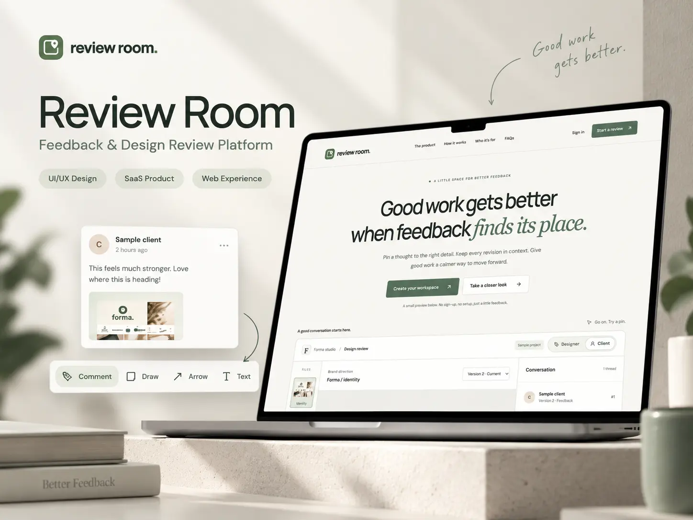

# Review Room

Image feedback, revisions and client decisions in one workspace.

[Live app](https://rreviewroom.vercel.app) · [Try the demo](https://rreviewroom.vercel.app/demo) · [Architecture](docs/ARCHITECTURE.md)



Review Room is an independent portfolio project for reviewing creative work. A comment belongs to a detail in an image, and a decision belongs to a particular version. That keeps “could you change this?” attached to the work it refers to.

## What you can do

- Sign in with email/password or Google, then work in your own workspace with a cookie-based session.
- Create projects and assign designers or clients. Owners see all projects in their workspace; everyone else sees their assigned projects.
- Upload JPG, PNG or WebP images to private storage. New versions preserve earlier files, feedback and decisions.
- Pin a comment, reply in a thread, and resolve or reopen the discussion.
- Compare versions and record each assigned client's approval or change request. A revision needs a fresh review.
- Invite someone by email-bound link, or share one version through an expiring, revocable read-only link. The owner copies and sends links; the app does not send invitation emails.
- Follow project activity with a separate unread position for each person.

The public demo has three fictional design concepts and two versions each. Visitors get separate 24-hour guest sessions, can switch between Designer and Client views, and can reset their sample feedback. Demo sessions cannot upload files, send invitations or access real workspaces.

The homepage has its own interactive review preview: choose a sample design, switch versions and try Designer or Client view. Add pinned feedback, reply to threads, resolve discussions, request changes or approve a version, then reset. Its state stays in the browser; it does not start a guest session or call a mutation API. The full `/demo` is a separate walkthrough backed by an isolated guest session.

The marketing page includes the review workflow, feature examples, use cases, privacy/collaboration details and an accessible FAQ. It adapts down to 320px, supports keyboard interaction and respects reduced-motion preferences.

## How it is built

One Next.js App Router application serves the UI and backend. Supabase supplies Auth and private Storage; Prisma's PostgreSQL adapter handles application data.

| Area               | Implementation                                                                                  |
| ------------------ | ----------------------------------------------------------------------------------------------- |
| Application        | Next.js 16 App Router, React 19, TypeScript                                                     |
| Data               | PostgreSQL, Prisma 7 and the `pg` driver adapter                                                |
| Identity and files | Supabase Auth with `@supabase/ssr`, private Supabase Storage                                    |
| Interface          | CSS Modules for marketing, application CSS, Tailwind 4 utilities and source-owned UI primitives |
| Typography         | Self-hosted DM Sans and Manrope; homepage headings use `next/font/local`                        |
| Hosting            | Vercel, with separate production/Preview backend guards                                         |

Private requests verify the user on the server, check project access and run database work under a transaction-scoped role with PostgreSQL row-level security. The browser has no direct app-table grants. Preview deployments reject production backend credentials.

See [architecture and tradeoffs](docs/ARCHITECTURE.md) for request flows, the permission model and the reasons behind version-bound feedback.

## Run locally

Use Node.js 22.18+ and pnpm 11.21.0. PostgreSQL 18 tools are needed for the optional local database/test cluster.

```sh
pnpm install --frozen-lockfile
pnpm dev
```

Open http://localhost:3000. The public homepage and its browser-only preview do not need backend credentials. Login, uploads, private projects and the full `/demo` do need a configured backend.

For the complete workflow, copy `.env.example` to `.env` **only if you do not already have one**. Configure a separate development Supabase project: its public URL/key, private server key, matching database connections, private bucket and signup hook. Keep the local app URL at `http://localhost:3000`. The app uses immediate email signup with confirmation disabled; Google login additionally needs its provider and callback configuration. The exact setup is in [the runbook](docs/RUNBOOK.md).

After configuring that development project, apply its application migrations and start the app:

```sh
pnpm db:deploy
pnpm dev
```

`/app` requires login. New accounts start with an empty workspace. Local database fixtures do not create Auth accounts or populate an authenticated user's workspace.

| Route               | Purpose                                         |
| ------------------- | ----------------------------------------------- |
| `/`                 | Public homepage and browser-only review preview |
| `/demo`             | Isolated 24-hour guest walkthrough              |
| `/signup`, `/login` | Account creation and sign-in                    |
| `/app`              | Protected workspace entry                       |
| `/invite`, `/share` | Invitation and read-only share entry            |

For database-only development and permission tests, `pnpm db:local:start` creates an isolated loopback cluster on port **55432** and preserves existing `.env` files. Keep `TEST_DATABASE_URL` pointed at its `review_room_test` database. Stop it with `pnpm db:local:stop`; data is retained. A local PostgreSQL cluster alone does not supply Supabase Auth or Storage.

The Supabase project used by the live site is production. Do not use it for seeds, test fixtures or migration resets.

## Checks and build

| Command                 | Purpose                                                          |
| ----------------------- | ---------------------------------------------------------------- |
| `pnpm lint`             | ESLint, with warnings treated as failures                        |
| `pnpm typecheck`        | TypeScript                                                       |
| `pnpm test`             | Unit tests, no database required                                 |
| `pnpm test:integration` | Permission/concurrency checks on the guarded local test database |
| `pnpm format:check`     | Prettier                                                         |
| `pnpm build`            | Generate Prisma Client, then build Next.js                       |
| `pnpm release:smoke`    | 17 anonymous, read-only checks against the live release          |

`pnpm test:browser` is an optional macOS Chrome acceptance runner. It needs its own **non-production** Supabase project and refuses the live project's credentials. It creates and removes its own fixtures; it is separate from the read-only release checks.

## Find your way around

```text
src/app/                 Pages, route handlers and layouts
src/features/marketing/  Scoped homepage styles, navigation and local review preview
src/features/            Review, uploads, projects, sharing, activity and guest demo
src/lib/auth/            Session verification, signup and durable rate limiting
src/lib/data/            Authorized queries and transactional domain operations
src/lib/storage/         Private storage adapter
prisma/                  App-schema migrations and guarded local fixtures
supabase/                Browser access hardening and private bucket SQL
scripts/                 Local checks, maintenance and asset capture
tests/                  Unit and local PostgreSQL integration tests
```

## Documentation and release

Vercel builds the connected GitHub branch with `pnpm build`. Build generates the ignored Prisma Client explicitly, including when install dependencies are cached; migrations are a separate operator action. Production database TLS requires the configured Supabase CA certificate.

- [Release setup, Auth URLs, backups and rollback](docs/RELEASE.md)
- [Architecture](docs/ARCHITECTURE.md) · [Design decisions](docs/DECISIONS.md)
- [Screenshot gallery and reproduction](docs/screenshots/README.md)
- [Original brand assets](public/brand/README.md) · [Font licenses](public/fonts/README.md)

Screenshots use the real local UI with intercepted seeded demo responses, not customer work or production fixtures. Run `pnpm portfolio:capture` against a local production server to regenerate them. No customer, revenue or load-performance claims are made.
