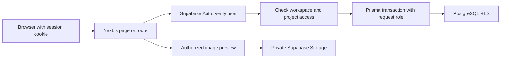

# How Review Room works

Review Room keeps the frontend and backend in one Next.js App Router application. The boundaries follow responsibilities: route handlers handle HTTP, feature modules own UI and input contracts, and data modules own authorized transactions. This keeps a small project deployable as one unit without putting database credentials or access decisions in browser code.

## The public homepage

The public homepage is a static Server Component. Only its mobile navigation and interactive review preview are Client Components. Marketing CSS is scoped separately from application styles, and the homepage loads the existing local Manrope font through `next/font/local`. The preview's reducer owns browser-only sample state; it reuses demo artwork/types and image-coordinate mapping without importing the demo API, Auth or database layer.

## A private request

The proxy refreshes session cookies, but it is not the permission boundary. Private data access independently verifies the user through Supabase Auth. The server then checks workspace membership and project assignment.

`withUserDatabase` uses `SET LOCAL ROLE review_room_user` and sets the verified subject inside a transaction. The role cannot bypass row-level security. Transaction-local identity matters with pooled connections: the next request must not inherit the previous person's context. Browser roles have no app-table grants, and the `app` schema stays outside the public Data API.

Owners can see every project in their own workspace. Designers and clients need a project assignment. Nested IDs are checked against the workspace/project, rather than accepted as proof of access. The server checks also produce useful application errors; RLS provides a second boundary when a query misses a tenant filter.

Start reading at [the transaction wrapper](../src/lib/data/context.ts), [permission checks](../src/lib/data/permissions.ts) and [workspace loaders](../src/lib/server/workspaces.ts).

## Feedback belongs to a version

An asset has an immutable sequence of versions. Finalization serializes publication so an older upload retry cannot become the current version after a newer one. Comments, replies and individual client decisions refer to a version, not just the asset.

A root comment stores `xRatio` and `yRatio` within the displayed image. For example, `xRatio = 0.25` is one quarter of the image width from the left. Resizing the canvas can move the displayed pin without changing its relation to the image. Click/drag detection separates adding a pin from panning a zoomed image.

Historical versions remain readable but cannot receive new comments, replies, resolves or decisions. A new version starts a new review. Each assigned client's decision stands on its own; the application does not turn one person's approval into a universal project sign-off.

See [coordinates](../src/features/comments/coordinates.ts), [comment transactions](../src/lib/data/comments.ts), [version/decision transactions](../src/lib/data/reviews.ts) and [version publication](../src/lib/data/uploads.ts).

## Images and storage

An authorized prepare step issues a bounded upload capability. Bytes go directly to private Supabase Storage, followed by server validation and finalization. Validation checks decoded bytes as well as file metadata: JPG/PNG/WebP, 10 MiB, at most 20 megapixels and an 8192px side limit. Animated or invalid images are rejected. Finalized originals cannot be overwritten.

The review UI requests authorized, bounded WebP previews rather than transferring the full original every time. Preview decoding applies EXIF orientation and removes metadata. New uploads save the oriented geometry so portrait images and their pins agree. Original downloads use separately authorized, short-lived signed URLs.

Previews are generated per request. This avoids a shared image cache crossing permission boundaries, at the cost of repeated decode/Storage work. Actual hosted throughput and cost have not been benchmarked.

## Invitations, shares and the public demo

Invitations are project-scoped and bound to an email address. Acceptance requires a confirmed matching identity. Because ordinary email signup intentionally skips confirmation, immediate workspace access alone is not proof of inbox ownership. Invitation links are copied and sent by the owner; there is no outbound email service.

A share exposes one fixed version and read-only threads. Raw capability tokens are exchanged from a URL fragment into scoped HttpOnly cookies. The database stores token hashes. Expiry and revocation are checked when serving shared content; already-issued original download URLs retain their short bounded lifetime.

The public demo has a separate `DemoSession` model and database request role. Its state contains only the original fictional catalog and sample feedback. It cannot access workspace tables. Signed guest cookies expire after 24 hours; durable session/network quotas bound creation and mutations. Reset changes content, while lifetime quotas and request receipts remain. Cleanup deletes only expired rows carrying the demo marker.

## Operations worth understanding

- Signup uses PostgreSQL rate buckets and a one-use provider-hook permit. It hashes the IP from the trusted Vercel header; it does not persist a raw client IP. Supabase's own limits remain enabled.
- Activity events are written in the same transaction as the change. A per-user read high-water mark never moves backwards when an older tab marks the feed read.
- Production requests require verified database TLS with the Supabase CA. Preview backend guards reject the live project's credentials before connecting.
- `pnpm build` generates Prisma Client before Next compiles. It does not run migrations. Deployment, migration and backup/restore are separate operations.
- The maintenance endpoint requires a Bearer secret and processes bounded batches. A scheduled invocation is an operational check, not something established by a successful build.

## What stays out of this version

No billing, AI summaries, video/PDF annotation, realtime cursors, automatic invitation email or mobile app. These would each introduce their own persistence, delivery or product decisions. The current project focuses on image feedback and version review.

[Release operations](RELEASE.md) · [Design decisions](DECISIONS.md)
