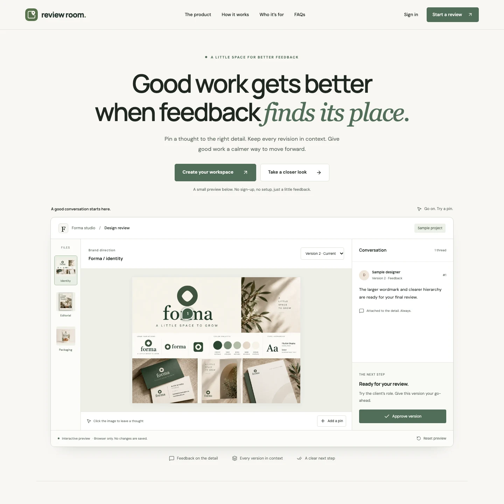
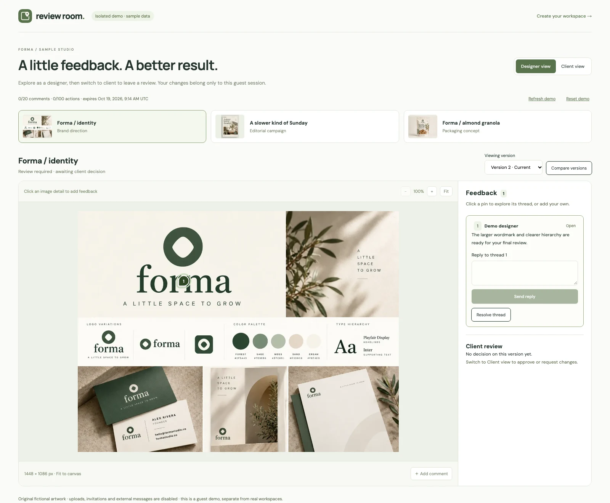
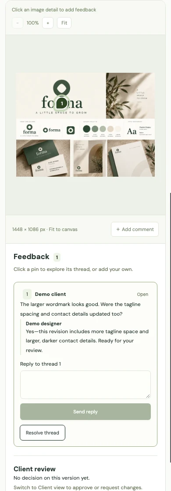
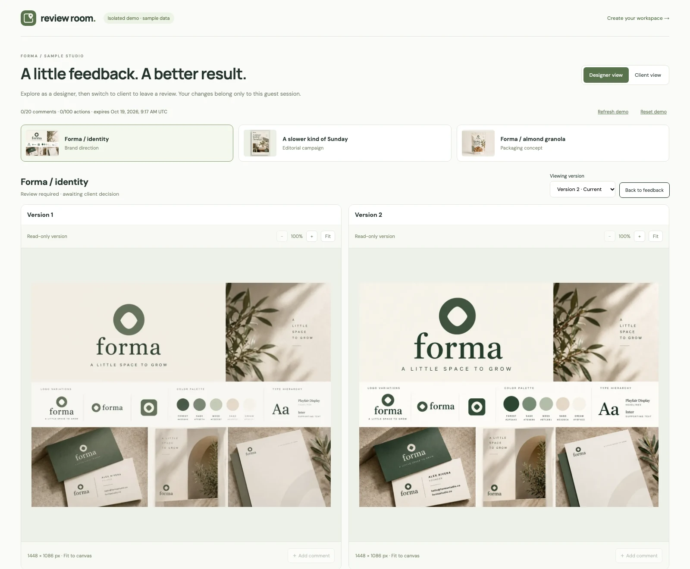
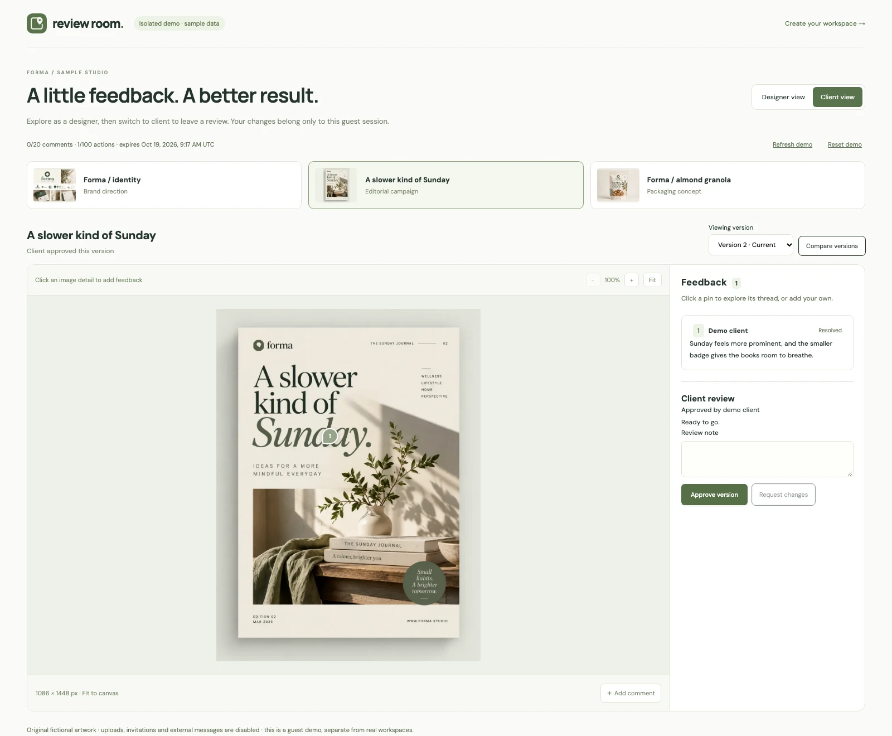

# Review Room — Visual Review and Client Approval

An independent concept project for keeping image feedback, revisions and client decisions together.

[Live application](https://rreviewroom.vercel.app) · [Interactive demo](https://rreviewroom.vercel.app/demo) · [Source](https://github.com/ataullah1/review-room)

## The problem

A message like “move this a little to the left” loses meaning when it sits several messages away from the image. Once a second file arrives, it also becomes unclear which feedback still applies and which version someone approved.

I built Review Room around those two questions: **which detail?** and **which version?** A pin answers the first; version-specific threads and decisions answer the second.

## My role and scope

My work covers the interface, data model, server workflows and deployment setup, developed with AI-assisted tooling. I chose a small image-review workflow rather than trying to reproduce a full project-management suite. The stack is Next.js, React, TypeScript, Prisma/PostgreSQL, Supabase Auth and private Storage.

This is a portfolio project, not a commissioned client engagement. All three demo designs are original fictional artwork. There are no customer, revenue or adoption claims.

## Put feedback beside the detail

The main screen gives most of the space to the image, with a thread beside it. Clicking an image creates a normalized position; the pin stays with that detail as the canvas changes size. Threads separate the original observation from follow-up replies. Designers can resolve a discussion without deleting its history.

On narrow screens the feedback follows the image. The private review workspace also has a feedback drawer, so navigation and comments do not squeeze the canvas into an unusable strip. Keyboard focus, retry states and preserving a draft after a failed save are part of that workflow.

## Keep earlier reviews intact

Uploading a revision creates an immutable version. Earlier files, comments and decisions remain attached to the earlier version. A historical view is read only, and the new version needs a fresh client review.

The comparison view keeps both images' aspect ratios intact. A client's decision records their own review of a particular version; it does not pretend that one approval represents everyone assigned to the project.

## Keep access explicit

Owners manage projects in their workspace. Designers and clients see assigned projects. Each private request verifies the identity on the server, checks resource access and performs database work under transaction-scoped PostgreSQL RLS. Browser roles cannot query application tables directly.

Image access follows the same permission boundary. Originals live in a private bucket; the UI receives authorized, metadata-free previews. Invitations are email-bound, and read-only shares expose one fixed version with expiry and revocation. Owners send invitation links themselves.

The public demo uses separate expiring guest records, so visitors can explore without seeing real projects. Its Designer/Client switch affects sample state only. Reset preserves lifetime quotas rather than becoming a way to bypass them.

## Technical choices I can explain

| Choice                     | Reason and tradeoff                                                                                                               |
| -------------------------- | --------------------------------------------------------------------------------------------------------------------------------- |
| One Next.js app            | UI and server changes ship together. Auth, data and storage still have separate modules.                                          |
| Normalized pin coordinates | Pins survive responsive resizing. EXIF orientation and displayed image geometry must still agree.                                 |
| Immutable versions         | Old feedback stays understandable. Publication needs serialization so retries cannot replace a newer current version.             |
| Server checks plus RLS     | Useful application errors and a database permission boundary. Transactions must carry the correct identity on pooled connections. |
| Per-request image previews | No shared cache leaking private images. Repeated decoding and Storage reads need measurement at real traffic.                     |
| PostgreSQL rate counters   | Limits persist across instances without an extra paid service. Atomic updates and cleanup still need care.                        |
| An isolated guest demo     | A reviewer can try the workflow without an account. Quotas, expiry and cleanup are part of the feature.                           |

The [architecture notes](ARCHITECTURE.md) connect these decisions to the source files.

## Verification and current release

The deployed site passes 17 automated anonymous checks covering public assets, metadata, private-route indexing rules and unauthenticated access rejection. Earlier development checks cover permissions, concurrency, uploads, comments, decisions, invitations, activity and demo isolation. The owner reports completing the live login/Google, review workflow, phone and operational setup checks discussed during release.

The portfolio screenshots show the real local production UI with intercepted seeded demo responses. They do not establish authenticated production behavior. No load benchmark, production restore rehearsal or third-party security certification is claimed. Search Console setup was owner-operated; Google indexing and ranking are not established by a sitemap submission.

## A short introduction for a portfolio card

**Review Room** is an image review workspace with pinned feedback, version comparison and client approvals. I designed and built the interface and full-stack workflow, including private uploads, project permissions, expiring shares and an isolated public demo.

**Tags:** Next.js · TypeScript · PostgreSQL · Supabase · Prisma

**Links:** [Live app](https://rreviewroom.vercel.app) · [Try demo](https://rreviewroom.vercel.app/demo) · [GitHub](https://github.com/ataullah1/review-room)

## 75-second walkthrough script

| Time   | What to show                                    | Narration                                                                                                                                                                         |
| ------ | ----------------------------------------------- | --------------------------------------------------------------------------------------------------------------------------------------------------------------------------------- |
| 0–10s  | Landing → Try demo                              | “Review Room gives creative work a place to be reviewed. The demo uses three original sample designs, so you can explore without an account.”                                     |
| 10–25s | Select a pin and its thread                     | “A comment belongs to a detail in the image. The pin stays in the same relative position as the canvas changes size, and replies keep the conversation together.”                 |
| 25–40s | Compare versions → return to feedback           | “Each revision keeps its own feedback. Side-by-side comparison shows what changed, while the earlier version stays read only. An old approval does not carry over to a new file.” |
| 40–55s | Switch to Client view; inspect Journal approval | “Assigned clients can approve a version or request changes with a note. Each person's decision is separate. This role switch changes only the guest demo.”                        |
| 55–67s | Mobile feedback                                 | “The review adapts to smaller screens. Real projects use server-checked assignments and private image storage; the public demo stays separate from that data.”                    |
| 67–75s | Return to overview                              | “I built Review Room to keep feedback specific, preserve revision history and make the next review step clear.”                                                                   |

The script is ready for recording; no narrated video has been recorded. Use only the fictional demo, keep developer tools closed and do not expose private links or credentials. See the [screenshot gallery](screenshots/README.md) for the five prepared stills and how to regenerate them.
